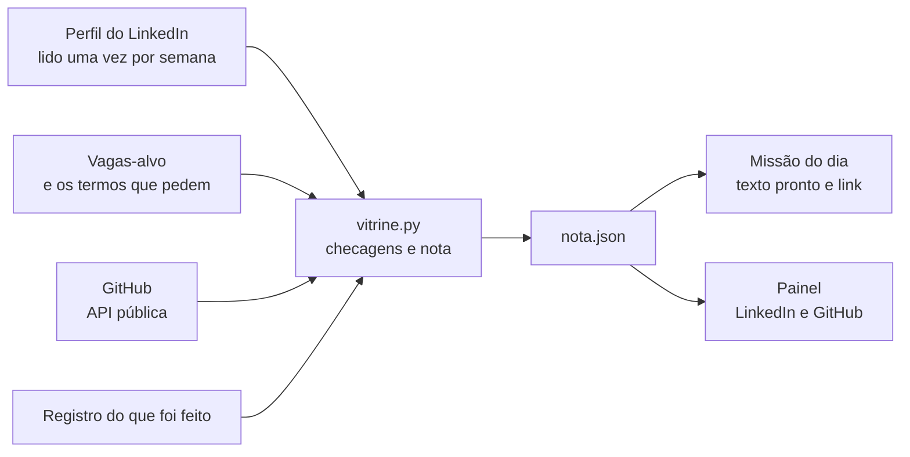

# Vitrine

Mede o perfil do LinkedIn e o GitHub como vitrine profissional, dá uma nota de
0 a 100 que pode ser medida de novo, e transforma o que derruba a nota em uma
tarefa curta por dia.

É uma skill do [Claude Code](https://claude.com/claude-code) com um motor de
nota em Python. O Claude lê o perfil, extrai os termos das vagas e escreve os
textos; o script conta os pontos. A nota não depende do modelo: a mesma entrada
dá sempre o mesmo número, e por isso dá para saber se o perfil melhorou.

## Como funciona



A nota tem quatro categorias. Cada uma é a soma de checagens simples, e cada
checagem diz o que achou e como subir.

| Categoria | Pontos | O que mede |
| --- | --- | --- |
| Aderência às vagas | 30 | Termos das vagas-alvo presentes no perfil. Requisito obrigatório pesa o dobro; termo comportamental pesa metade |
| Perfil | 25 | Título, sobre, experiências com número e verbo de ação, competências, foto, endereço |
| Vitrine de projetos | 25 | Link do GitHub no perfil, destaques, projetos e, em cada repositório: descrição, README, imagem, tópicos, licença, atualização |
| Atividade e rede | 20 | Posts, comentários, convites, conexões e recomendações |

A rotina muda conforme o dia da semana:

| Dia | Rotina | O que entrega |
| --- | --- | --- |
| Segunda | `medir` | Relê perfil e vagas, nota nova, plano da semana |
| Terça | `perfil` | Um trecho do perfil reescrito |
| Quarta | `vitrine` | Um projeto arrumado no GitHub e a entrada dele no LinkedIn |
| Quinta | `topico` | Um assunto da área, com fonte, e o post pronto |
| Sexta | `conexoes` | Pessoas para convidar, com nota de convite, e comentários |
| Sábado | `bastidor` | Post sobre o que foi construído na semana |
| Domingo | `fechamento` | Resumo da semana |

## Rodar com os dados de exemplo

Precisa só de Python 3 (testado com 3.13). Não há dependência externa.

A pasta `exemplo/` tem um perfil, vagas e um GitHub fictícios. Aponte a
variável `VITRINE_HOME` para ela:

```bash
export VITRINE_HOME="$PWD/exemplo"
python skill/scripts/vitrine.py nota
python skill/scripts/vitrine.py hoje
```

No PowerShell:

```powershell
$env:VITRINE_HOME = "$PWD\exemplo"
python skill\scripts\vitrine.py nota
python skill\scripts\vitrine.py hoje
```

`nota` grava `nota.json` e acrescenta uma linha em `historico.jsonl`. `hoje`
diz a rotina do dia e as checagens com mais pontos em aberto.

| Comando | O que faz |
| --- | --- |
| `init` | Cria a pasta de estado e um `alvo.json` vazio |
| `github` | Lê os repositórios públicos do usuário de `alvo.json` |
| `nota` | Roda as checagens e grava a nota |
| `hoje` | Mostra a rotina do dia e as checagens candidatas |
| `registrar` | Anota um post, comentário, convite ou missão feita |

## Instalar como skill

```powershell
powershell -ExecutionPolicy Bypass -File instalar.ps1
```

O script copia `skill/` para `~/.claude/skills/vitrine` e cria a pasta de
estado em `~/.claude/vitrine`. Depois, preencha `alvo.json` (quem é você,
cargos-alvo, repositórios de estudo, o que nunca citar) e peça ao Claude:
"rode a vitrine".

Para rodar todo dia sem pedir, use `agendamento/tarefa-diaria.md` como modelo
de tarefa agendada.

## Painel

`painel/` gera os dados de um painel com duas abas, LinkedIn e GitHub, cada uma
com resumo, nota, o que mais sobe a nota, perfil, atividade, vagas e checagens.

```bash
python painel/ler_github.py   # leitura ampliada do GitHub: commits, linguagens, fixados
python painel/exportar.py     # tabelas em <estado>/painel/dados/ e a página em pagina.json
```

A página (`painel/index.html`) foi escrita para o tipo Dashboard dos Artifacts
do Claude, que carrega as tabelas e mostra de onde vem cada número. Ela não
abre sozinha no navegador.

## Estrutura

```
skill/
  SKILL.md               instruções da rotina, limites e formato da mensagem
  references/            roteiro de cada dia, formatos dos arquivos, origem das checagens
  scripts/vitrine.py     motor de nota
painel/
  ler_github.py          leitura ampliada do GitHub
  exportar.py            estado -> tabelas do painel
  index.html             página do painel
exemplo/                 estado fictício para testar
agendamento/             modelo da tarefa diária
tests/                   testes do motor de nota
```

## Limites e privacidade

- **Nada é publicado pela ferramenta.** Ela prepara o texto; quem cola e envia
  é a pessoa. Nenhum clique em Enviar, Publicar ou Conectar, nenhum commit ou
  push numa rodada sem a pessoa presente.
- **LinkedIn é só leitura**, do próprio perfil, no máximo uma vez por semana.
- **GitHub é lido pela API pública.** Não precisa de token; se a variável
  `GITHUB_TOKEN` existir, ela é usada só para aumentar o limite de leituras.
- **Só fatos com origem.** Todo texto sai de `fatos.md`, onde cada linha diz de
  onde veio. Termo de vaga sem prova não entra no perfil: vira lacuna para
  estudar ou ignorar.
- **O estado fica fora do repositório.** Perfil, vagas, fatos e diário moram em
  `~/.claude/vitrine`. O que está em `exemplo/` é fictício.

## Testes

```bash
python -m unittest discover -s tests -v
```

Os testes cobrem a regra de comparação de termos, os pesos, a nota dos dados de
exemplo e a divisão das checagens entre LinkedIn e GitHub.

## Como foi feito

O projeto foi desenvolvido com o Claude Code, e a rotina diária é executada por
ele. O motor de nota é Python puro e pode ser lido, testado e alterado sem o
Claude.

## Licença

MIT. Veja [LICENSE](LICENSE).
